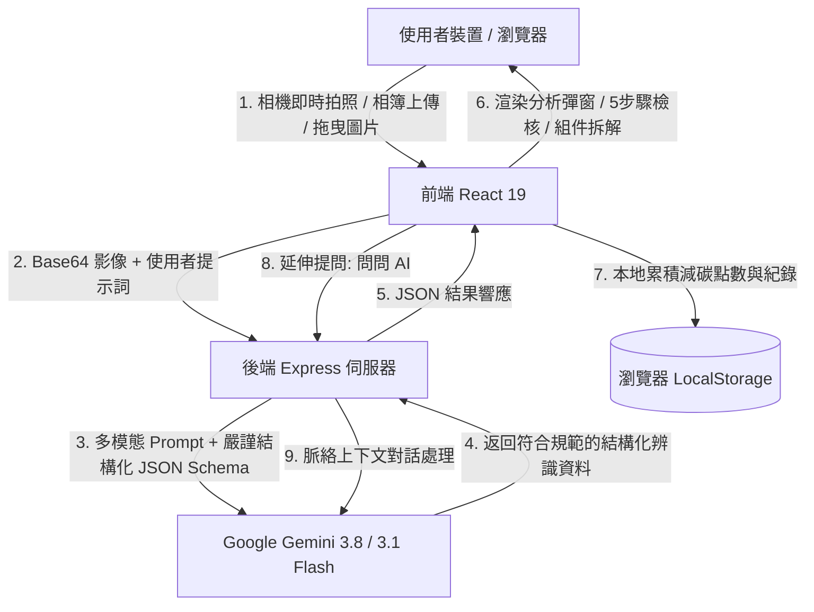

# 🌱 EcoSort AI - 智慧垃圾分類辨識助手 (Smart Waste Classifier & Reduction Assistant)

> 一款基於 **Google Gemini 視覺模型** 的智慧環保 Web 應用。使用者可透過**手機/電腦鏡頭即時掃描**、**相簿照片上傳**或**拖曳圖片**，自動辨識廢棄物種類、指示對應投遞桶別、細部拆解複合材質，並提供互動式清洗檢核表與「源頭減量」生活提案。

👉 **[🌐 線上即時體驗 Demo (GitHub Pages)](https://annie10323.github.io/ecosort-ai/)**

[](https://react.dev/)
[](https://www.typescriptlang.org/)
[](https://vitejs.dev/)
[](https://tailwindcss.com/)
[](https://expressjs.com/)
[](https://ai.google.dev/)
[](LICENSE)

---

## 📌 目錄 (Table of Contents)

1. [✨ 核心特色與亮點](#-核心特色與亮點)
2. [🗺️ 台灣資源回收分類與桶別對照](#️-台灣資源回收分類與桶別對照)
3. [🏗️ 系統架構與資料流](#️-系統架構與資料流)
4. [📁 專案目錄結構](#-專案目錄結構)
5. [🛠️ 技術棧與依賴](#️-技術棧與依賴)
6. [🚀 快速開始 (Quick Start)](#-快速開始-quick-start)
7. [🔌 後端 API 規格說明](#-後端-api-規格說明)
8. [💡 特色實踐細節](#-特色實踐細節)
9. [❓ 常見問題 (FAQ)](#-常見問題-faq)
10. [📄 授權條款](#-授權條款)

---

## ✨ 核心特色與亮點

1. 📷 **多途徑影像輸入與即時掃描**
   - **鏡頭即時預覽**：支援前後鏡頭切換、輔助雷射對準框、即時快門拍照。
   - **相簿上傳 & 拖曳**：支援直接選取圖檔或拖曳至視窗辨識（上限支援達 25MB 高畫質照片）。
   - **內建 SVG 測試樣品**：手搖飲料杯、紙餐盒、廢乾電池、寶特瓶、廚餘、深色玻璃瓶等，手邊沒有垃圾也能即刻體驗。

2. 🧩 **複合材質細部拆解 (Multi-part Breakdown)**
   - 針對現代外帶包裝複合材質（如：手搖杯 = PP杯身 + 複合封膜 + 塑膠吸管；咖啡杯 = 紙容器杯身 + 塑膠蓋 + 牛皮紙套）進行多部位獨立拆解。
   - 明確指示各部位應丟棄的目標垃圾桶與前置處置方式。

3. ✅ **互動式處置 5 步驟檢核表**
   - 包含「倒空殘渣 ➔ 拆解零件 ➔ 清水沖洗 ➔ 瀝乾壓扁 ➔ 分類投入」步驟式 Checklist，完成後給予紙花獎勵與綠色點數。

4. 💡 **源頭減廢生活提案 (Waste Reduction Tips)**
   - 不只教「怎麼丟」，更指導「如何少丟」！依據辨識物品提供 2~4 點具體可行的減量提案（如循環容器租借、自備環保杯優惠、充電電池替代方案等）。

5. 🔊 **Web Speech API 語音朗讀**
   - 點擊喇叭按鈕即可朗讀辨識結果與處置重點，友善長輩與忙碌雙手。

6. 💬 **針對該物品的「問問 AI」延續對話**
   - 若對特定污損狀況有疑慮（例如「沾滿肉汁的披薩紙能回收嗎？」），可直接在卡片下方發問，AI 即時精準回覆。

7. 📚 **常見陷阱圖鑑與環保知識測驗**
   - **分類圖鑑**：搜尋並對照感熱紙發票、生熟廚餘區分、保麗龍、氣泡袋等常見易混淆物品。
   - **知識測驗**：內建 7 題環保生活情境題，測驗完畢可取得專屬環保徽章。

8. 📊 **減碳點數與掃描歷程**
   - 本地儲存（LocalStorage）記錄每次掃描歷程、分類結果與累積累積減碳量（kg CO₂）。

---

## 🗺️ 台灣資源回收分類與桶別對照

| 桶身主題色 | 分類類別 (Category) | 範例物品 | 處置重點 |
| :--- | :--- | :--- | :--- |
| 🟨 **黃色 (Yellow)** | 塑膠回收 (`RECYCLABLE_PLASTIC`) | 寶特瓶 (PET)、手搖杯 (PP)、清潔劑瓶 (HDPE) | 倒空沖洗、壓扁、撕除封膜與吸管 |
| 🟧 **琥珀色 (Amber)** | 紙容器類 (`RECYCLABLE_PAPER_CONTAINER`) | 紙餐盒、紙咖啡杯、鋁箔包/利樂包 | 具 PE 淋膜，**嚴禁混入一般紙類** |
| 🟦 **藍色 (Blue)** | 一般紙類 / 玻璃 (`RECYCLABLE_PAPER` / `GLASS`) | 紙箱、報紙、雜誌、玻璃瓶罐 | 紙箱需拆平，玻璃瓶需清空沖洗 |
| 🟩 **綠色 (Green)** | 生廚餘 / 堆肥 (`FOOD_WASTE_RAW`) | 果皮、菜葉、果核、咖啡渣、茶葉渣 | 瀝乾水分，大骨與硬殼勿入 |
| 🟤 **咖啡色 (Brown)** | 熟廚餘 / 養豬 (`FOOD_WASTE_COOKED`) | 剩飯、熟肉食、麵條等煮熟剩菜殘渣 | 不得含有骨頭、塑膠袋或牙籤 |
| 🟥 **紅色 (Red)** | 有害廢棄物 (`HAZARDOUS_WASTE`) | 乾電池、鈕扣電池、鋰電池、日光燈管 | 嚴禁混入一般垃圾，送超商/專用回收箱 |
| ⬜ **灰色 (Stone)** | 一般垃圾 (`GENERAL_WASTE`) | 電子發票(感熱紙)、油膩披薩襯紙、吸管、封膜、大骨頭、蚌殼 | 投入專用垃圾袋送焚化爐焚化 |

---

## 🏗️ 系統架構與資料流



---

## 📁 專案目錄結構

```text
ecosort-ai/
├── .env.example               # 環境變數範例檔 (GEMINI_API_KEY)
├── .gitignore                 # Git 忽略設定
├── bun.lock                   # Bun lockfile (若使用 bun)
├── index.html                 # 應用入口 HTML (含 Google Fonts & Lucide 設置)
├── metadata.json              # 專案元數據與權限配置
├── package.json               # 專案相依性套件與執行腳本
├── server.ts                  # 後端 Express 伺服器 (Gemini SDK 調用 & Vite 整合)
├── tsconfig.json              # TypeScript 編譯設定檔
├── vite.config.ts             # Vite 建置與 Tailwind 配置
└── src/
    ├── main.tsx               # React 根節點渲染入口
    ├── App.tsx                # 主應用程式 (導覽、狀態管理、歷程同步)
    ├── index.css              # 全域 CSS 與 Tailwind 核心樣式
    ├── types.ts               # 全域 TypeScript 介面定義
    ├── components/
    │   ├── Header.tsx         # 頂部導覽列與點數徽章顯示
    │   ├── CameraScanner.tsx  # 鏡頭掃描介面、照片上傳、測試樣品輪播
    │   ├── AnalysisModal.tsx  # 辨識結果彈窗、5步檢核表、材質拆解、問問AI、語音播報
    │   ├── GuideSection.tsx   # 分類避坑圖鑑與關鍵字搜尋
    │   ├── QuizSection.tsx    # 7題互動式環保分類隨堂測驗
    │   └── ScanHistory.tsx    # 本地掃描歷程記錄與減碳統計卡片
    ├── data/
    │   ├── guideData.ts       # 常見垃圾分類圖鑑資料庫 (避坑秘訣)
    │   ├── quizData.ts        # 環保隨堂題目與詳細解析
    │   └── sampleItems.ts     # 預設的高畫質 SVG 垃圾測試樣品
    └── utils/
        └── audio.ts           # Web Speech 語音合成與音效工具 (TTS & 音效反饋)
```

---

## 🛠️ 技術棧與依賴

### 前端 (Frontend)
- **核心框架**：React 19 (`react`, `react-dom`)
- **語言支援**：TypeScript
- **建置工具**：Vite 8.3
- **CSS 樣式**：Tailwind CSS 4.0
- **圖示庫**：Lucide React
- **動畫與回饋**：Canvas Confetti（通關紙花灑落）
- **音訊與語音**：Web Speech API (`speechSynthesis`)

### 後端 (Backend)
- **伺服器架構**：Node.js + Express 4.21
- **開發伺服器**：`tsx`（即時執行 TypeScript 伺服器）
- **整合架構**：開發模式下 Express 掛載 Vite 中間件；生產模式下託管靜態 SPA。

### 人工智慧 (AI Core)
- **SDK**：`@google/genai` (Google Gen AI SDK 官方套件)
- **多模型容錯機制**：優先採用 `gemini-3.1-flash-lite`、`gemini-3.8-flash` 與 `gemini-flash-latest` 候選集自動重試。
- **結構化輸出 (Structured Outputs)**：透過 `responseMimeType: 'application/json'` 與 `responseSchema` 保證 100% 格式無損解析。

---

## 🚀 快速開始 (Quick Start)

### 1. 取得專案檔案
進入專案所在目錄：
```bash
cd project-2
```

### 2. 安裝相依套件
使用 npm 或 pnpm / bun：
```bash
npm install
```

### 3. 設定環境變數
在專案根目錄建立 `.env` 檔案（可參考 `.env.example`）：
```env
# Google Gemini API Key（可在 Google AI Studio 免費申請）
GEMINI_API_KEY="你的_GEMINI_API_KEY"

# 伺服器埠號（選填，預設為 3000）
PORT=3000
```

> 🔑 **如何取得 Gemini API Key？**
> 1. 造訪 [Google AI Studio](https://aistudio.google.com/)。
> 2. 登入 Google 帳號後，點擊 **Get API key**。
> 3. 建立並複製 API Key，填入 `.env` 中的 `GEMINI_API_KEY` 欄位。

### 4. 啟動開發伺服器
```bash
npm run dev
```

啟動成功後，打開瀏覽器前往：
```text
http://localhost:3000
```

---

## 📦 生產環境建置與部署 (Production)

### 建置靜態檔案
```bash
npm run build
```

### 啟動正式伺服器
```bash
npm start
```

---

## 🔌 後端 API 規格說明

### 1. 垃圾分類影像辨識
- **端點**：`POST /api/classify`
- **Content-Type**：`application/json`
- **Request Body**：
  ```json
  {
    "imageBase64": "data:image/jpeg;base64,...",
    "mimeType": "image/jpeg",
    "region": "tw",
    "userPrompt": "這是外帶手搖杯"
  }
  ```
- **Response**：
  ```json
  {
    "success": true,
    "result": {
      "itemName": "外帶手搖飲料塑膠杯",
      "englishName": "Takeaway Boba Plastic Cup",
      "category": "RECYCLABLE_PLASTIC",
      "categoryName": "塑膠回收",
      "targetBinColor": "yellow",
      "confidence": 0.95,
      "summary": "杯身洗淨壓扁投塑膠回收，封口膜與吸管撕除丟一般垃圾",
      "disposalSteps": [
        "1. 倒空殘留冰塊、茶水與珍珠",
        "2. 撕下塑膠封口膜並將吸管抽出丟一般垃圾",
        "3. 用少量清水沖洗杯內殘留糖分",
        "4. 壓扁杯身減少體積後投入塑膠類回收桶"
      ],
      "componentsBreakdown": [
        {
          "partName": "杯身",
          "material": "PP 5號",
          "targetBin": "塑膠回收",
          "actionNote": "沖洗瀝乾後壓扁"
        },
        {
          "partName": "塑膠封口膜",
          "material": "複合塑膠/黏膠",
          "targetBin": "一般垃圾",
          "actionNote": "帶有黏膠無法回收"
        },
        {
          "partName": "細塑膠吸管",
          "material": "PP複合材質",
          "targetBin": "一般垃圾",
          "actionNote": "體積過小且容易髒污"
        }
      ],
      "recyclingCode": "♷ 5號 PP",
      "ecoImpact": "妥善回收1個PP杯可減少約45g碳足跡",
      "commonMistakes": "常有人連同封膜和吸管一起丟回收，造成回收廠分選困難",
      "cleanlinessRequirement": "必須沖洗倒空，若含過多茶漬發霉需加強清潔",
      "wasteReductionTips": [
        "出門隨身自備環保杯，在台灣連鎖飲料店可現折 5 元",
        "利用店家提供的循環杯借還服務",
        "使用不鏽鋼、玻璃或矽膠等重複性吸管替代一次性塑膠吸管"
      ]
    }
  }
  ```

### 2. 延續諮詢問答 (Chat Follow-up)
- **端點**：`POST /api/chat-followup`
- **Request Body**：
  ```json
  {
    "itemName": "便當盒",
    "categoryName": "紙容器類",
    "question": "如果便當盒底部沾滿厚厚的咖哩油洗不乾淨，還能回收嗎？"
  }
  ```
- **Response**：
  ```json
  {
    "success": true,
    "answer": "如果紙餐盒沾滿厚厚咖哩油且完全無法洗淨，殘留油脂會破壞再生紙漿的成形品質，此時請直接投入「一般垃圾」處理，切勿混入回收造成整批污染！"
  }
  ```

### 3. 健康檢查
- **端點**：`GET /api/health`
- **Response**：
  ```json
  { "status": "ok", "service": "ecosort-ai-server" }
  ```

---

## 💡 特色實踐細節

### 1. 嚴謹的系統提示詞 (System Prompting)
專案內建台灣環保署權威回收規則提示詞，針對「紙容器 vs 純紙類」、「生廚餘 vs 熟廚餘」、「過度油損之紙張判定」等容易出錯的關鍵點進行加強約束，確保模型判定精確。

### 2. 多模型候選與容錯重試機制
在 `server.ts` 內建立了容錯陣列 `['gemini-3.1-flash-lite', 'gemini-3.8-flash', 'gemini-flash-latest']`，每種模型具備重試延遲，大幅降低 API Rate Limit 或高負載時的失敗率。

### 3. 離線 SVG 測試樣品設計
為了讓評審或無垃圾在旁的測試者能即時體驗，`sampleItems.ts` 使用向量 SVG 模擬真實垃圾（帶有茶水珍珠的手搖杯、有骨頭肉汁的便當盒、電池、玻璃瓶等），直接轉換為 Data URL 傳輸，體驗流暢零門檻。

---

## ❓ 常見問題 (FAQ)

1. **鏡頭無法啟動或顯示黑畫面？**
   - 請檢查瀏覽器網址列右方或設定中的「鏡頭權限」是否設為「允許」。
   - 桌機若無攝影機，可點擊「開啟相簿選取照片」或點選下方內建的「測試樣品」快速體驗。

2. **辨識時出現「模型辨識服務忙碌」？**
   - 請檢查根目錄 `.env` 的 `GEMINI_API_KEY` 是否有效。
   - 若短時間內請求次數過多，可稍候數秒再次點擊辨識，系統會自動在候選模型間重試。

3. **如何新增自訂的測驗題目或避坑圖鑑？**
   - 測驗題目位於 `src/data/quizData.ts`，可直接增加或修改題目結構。
   - 分類避坑圖鑑位於 `src/data/guideData.ts`，可依需求補充各縣市特定分類條目。

---

## 📄 授權條款

本專案採用 **Apache-2.0** 授權開源。
